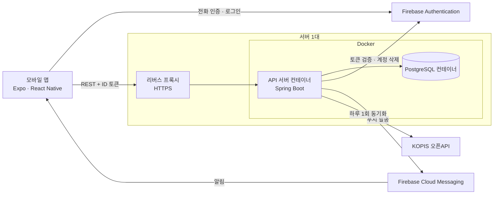
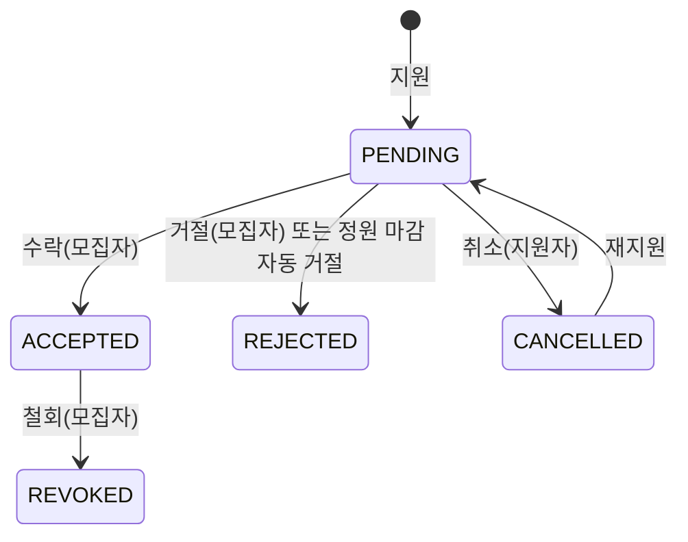

# Allargando

악기 취미생이 앙상블·버스킹 멤버를 **무보수로** 모집하고 지원하는 모바일 앱.

## 개요

| 항목 | 내용 |
| --- | --- |
| 대상 | 악기를 취미로 하는 사람(전공·경력 무관) |
| 플랫폼 | Android — Google Play 출시 준비 중 |
| 구성 | Spring Boot API 서버 + Expo(React Native) 앱 모노레포 |
| 인원 | 2인(기획·백엔드·앱·배포 전 과정) |

- 백엔드 실행·배포: [`backend/README.md`](backend/README.md)
- 앱 실행: [`Frontend/Allargando/README.md`](Frontend/Allargando/README.md)
- 코드 규칙·설계 결정 상세: [`CLAUDE.md`](CLAUDE.md)

## 사용 흐름

1. 모집자가 공연 일시·장소와 **악기별 모집 인원**을 적어 모집글을 올림
2. 지원자가 악기를 고르고 어필 문구를 적어 지원함
3. 모집자가 닉네임·악기·활동 이력·어필 문구를 보고 수락 또는 거절함
4. **수락된 지원만** 모집자에게 이름·전화번호가 공개됨. 앱 안에 채팅은 없고 이후 연락은 당사자끼리 함
5. 악기 정원이 차면 그 악기는 자동 마감되고, 같은 악기의 남은 대기 지원은 자동 거절


## 핵심 기능

| 기능 | 내용 |
| --- | --- |
| 모집글 | 제목·분류·공연 일시·장소·지역·타임테이블·설명과 악기별 정원(악기 최대 10개)을 등록. 분류·악기·지역·기간·상태로 걸러 보고, 작성자는 수정·수동 마감·재개·삭제 가능 |
| 지원·수락 | 악기를 골라 지원, 대기 중에는 취소 가능하고 취소한 글에는 다시 지원 가능. 모집자는 수락·거절·수락 철회. 정원이 차면 자동 마감 |
| 연락처 보호 | 지원자 이름·전화번호는 수락 전까지 `홍**`·`010-****-5678`로 가려짐. 글만 올려 연락처를 모으는 남용 방지 목적 |
| 연주회 정보 | KOPIS(공연예술통합전산망) 오픈API를 하루 한 번 동기화해 클래식·국악·대중음악 공연을 분류·지역·기간으로 조회 |
| 연습 일지 | 날짜·연습 시간(분)·제목·내용을 기록하는 개인 일지 |
| 푸시 알림 | 새 모집글, 내 글에 들어온 지원, 지원 결과(수락·거절), 지원한 글의 수정·삭제 |
| 신고·차단 | 모집글·유저 신고(사유 5종), 유저 차단. 차단하면 그 유저의 글이 목록에서 빠지고 그 유저는 내 글에 지원할 수 없음 |
| 계정 | 전화번호 문자 인증으로 1인 1계정. 아이디·비밀번호 로그인, 전화 인증으로 아이디 찾기·비밀번호 재설정. 탈퇴하면 남긴 데이터 전부 삭제 |

## 화면 구성

| 탭 | 화면 내용 |
| --- | --- |
| 연습 일지 | 내 일지 목록(무한 스크롤), 카드를 누르면 상세 모달, 작성·수정 화면으로 이동 |
| 홈 | 모집글 목록. 상단 필터(분류·악기·지역·기간), 무한 스크롤, 당겨서 새로고침, 글 등록 버튼 |
| 연주회 | 연주회 목록. 필터(분류·지역·기간), 카드를 누르면 상세 모달 |
| 마이 페이지 | 내 프로필, 내가 올린 모집글, 내가 낸 지원(취소 가능), 설정(내 정보 수정·차단 목록·로그아웃·탈퇴) |

탭 밖의 화면은 아래와 같음.

| 화면 | 내용 |
| --- | --- |
| 로그인 | 아이디·비밀번호 로그인, 가입·계정 찾기 진입 |
| 회원가입 | 아이디·비밀번호·약관 동의 → 이름·닉네임(중복 확인)·악기·전화번호 문자 인증 → 활동 이력(선택) 입력 후 제출. 중간에 끊긴 계정은 다음 로그인 때 끊긴 단계부터 이어감 |
| 계정 찾기 | 전화번호 인증 후 아이디 확인 또는 새 비밀번호 설정 |
| 모집글 상세 | 글 내용과 악기별 모집 현황. 지원자에게는 지원 버튼과 내 지원 상태, 작성자에게는 수정·마감·재개·삭제와 지원자 관리 진입. 신고 메뉴 |
| 모집글 작성·수정 | 글 정보와 악기별 정원 입력 |
| 지원자 관리 | 작성자 전용. 지원자별 악기·활동 이력·어필 문구를 보고 수락·거절·철회 |
| 유저 프로필 | 닉네임·악기·활동 이력만 공개. 신고·차단 메뉴 |
| 내 정보 수정 · 차단 목록 | 닉네임·악기·활동 이력 수정, 차단 해제 |
| 업데이트 안내 | 서버가 더 지원하지 않는 버전이면 앱 전체가 스토어 안내 화면으로 바뀜 |

## 시스템 구성



### 기술 스택

| 영역 | 사용 기술 |
| --- | --- |
| 백엔드 | Java 21, Spring Boot 3.5, Spring Data JPA, Spring Security, Flyway, springdoc-openapi |
| 데이터 | PostgreSQL 16 |
| 앱 | Expo SDK 57, React Native 0.86, React 19, expo-router, TypeScript |
| 외부 서비스 | Firebase Authentication(전화·아이디 로그인), Firebase Cloud Messaging, KOPIS 오픈API |
| 테스트 | JUnit 5, Mockito, `@WebMvcTest`, H2, 실제 PostgreSQL 대상 통합 테스트 |
| CI·배포 | GitHub Actions(백엔드 테스트·이미지 빌드, 앱 타입 검사·린트), Docker, EAS Build |

**※ 저장소 구조** 

```
backend/allargando     API 서버
Frontend/Allargando    모바일 앱
web                    약관·개인정보처리방침·계정 삭제 안내 페이지
```

## 핵심 흐름

### 지원 상태



| 상태 | 의미 | 연락처 공개 |
| --- | --- | --- |
| `PENDING` | 대기 | 가려짐 |
| `ACCEPTED` | 수락. 그 악기의 확정 인원이 1 늘어남 | **공개** |
| `REJECTED` | 거절. 다시 지원할 수 없음 | 가려짐 |
| `CANCELLED` | 지원자가 취소. 같은 지원을 되살려 다시 지원 가능 | 가려짐 |
| `REVOKED` | 수락 철회. 확정 인원이 1 줄고 자리가 다시 열림 | 가려짐 |

- 상태 변경은 `accept`·`reject`·`cancel`·`revoke` 엔드포인트로 나뉘어 있어 누가 호출할 수 있는지가 경로 단위로 고정
- 공연일이 지난 글은 수락·철회 불가(거절·취소는 가능)


### 가입

1. 앱이 Firebase 전화 인증(문자)으로 로그인함
2. 그 계정에 아이디·비밀번호를 연결함. 아이디는 Firebase 이메일 로그인에 내부 형식으로 넣을 뿐이고 서버 DB에는 없음
3. 앱이 ID 토큰과 프로필(이름·닉네임·악기·활동 이력·약관 동의)로 가입 요청을 보냄
4. 서버가 토큰을 검증하고 토큰 안의 전화번호를 꺼내 저장함. 같은 계정으로 다시 요청이 오면 기존 결과를 그대로 돌려줌(멱등)

## API 구조

모든 응답은 `{ status, message, data }` 형식이며, 전체 엔드포인트와 요청·응답은 Swagger에서 확인

| 도메인 | 경로 | 하는 일 |
| --- | --- | --- |
| Auth | `/api/auth` | 가입, 푸시 토큰 등록·해제, 전화번호 변경 |
| User | `/api/users` | 내 정보 조회·수정, 탈퇴, 닉네임 확인, 공개 프로필 |
| Post | `/api/posts` | 모집글 등록·목록·상세·수정·마감·재개·삭제, 내가 올린 글 |
| Application | `/api/applications` | 지원, 내 지원 목록, 글별 지원자 목록, 수락·거절·취소·철회 |
| Concert | `/api/concerts` | 연주회 목록·상세 |
| Practice | `/api/practice-logs` | 연습 일지 등록·목록·상세·수정·삭제 |
| Report | `/api/reports` | 모집글·유저 신고 |
| Block | `/api/blocks` | 차단·차단 목록·해제 |

**공통 규약**

- 목록은 무한 스크롤용으로 `hasNext`·`currentPage`만 내려줌. 정렬은 서버가 정한 값만 받음(클라이언트가 임의 컬럼으로 정렬 불가)
- 오류 코드: 400 잘못된 요청 / 401 토큰 / 403 권한 / 404 없음·미가입 / 409 중복 / 426 앱 업데이트 필요 / 429 호출 빈도 초과 / 503 인증 서버 장애
- 호출 빈도 제한: 사용자당 분당 120회 기본, 글 등록 등은 엔드포인트별 한도 추가
- 강제 업데이트: 앱이 보내는 `X-App-Version`이 서버의 최소 버전보다 낮으면 426

## 기술 상세

- **인증** — 비밀번호·문자 인증은 Firebase가 맡고, 서버는 비밀번호를 저장하지 않음. 앱이 받은 ID 토큰을 요청마다 싣고 서버가 검증함
- **전화번호** — 요청 본문이 아니라 **검증된 토큰의 `phone_number` 값만** 신뢰함. 이 번호에 UNIQUE를 걸어 1인 1계정의 기준으로 씀
- **알림** — DB 커밋이 끝난 뒤 별도 스레드에서 발송함. 롤백된 작업의 알림은 나가지 않고, FCM이 느려도 요청 응답을 붙잡지 않음
- **운영 전제** — 서버 1대 전제임(호출 제한 카운터, 동기화 중복 실행 방지가 인스턴스 메모리에 있음)

## 트러블슈팅

### 1. 가입 요청이 겹치면 정상 계정까지 지워질 수 있던 문제

**증상** — 더블탭·재시도로 같은 계정의 가입 요청이 겹치면 한쪽이 UNIQUE 위반으로 실패함. 이때 실패한 쪽의 보상 처리(Firebase 계정 삭제)가 **먼저 성공한 쪽의 계정까지 지울 수 있었음**

**원인** — 보상 삭제는 "실패한 요청만 그 계정을 쓴다"고 가정했는데, 두 요청은 같은 Firebase 계정을 씀

**해결** — 보상 삭제를 없애고 가입을 멱등으로 바꿈. 저장이 UNIQUE 위반으로 실패하면 같은 계정을 다시 조회해, 이미 가입돼 있으면 그 결과를 그대로 반환

**검증** — 실제 PostgreSQL에 동시 가입을 보내는 테스트(`AuthServiceRegisterPostgresTest`)

### 2. 정원보다 많이 수락되거나, 찬 악기가 열려 보이던 문제

**증상** — 수락을 철회하면 악기가 무조건 다시 열렸고, 글 수정으로 정원을 수락 인원 밑으로 줄일 수도 있었음. 그래서 확정 인원이 정원을 넘거나, 찬 악기가 모집 중으로 남을 수 있었음

**해결** — 악기별 `0 <= 확정 인원 <= 정원`을 세 겹으로 지킴

1. 수락 인원 밑으로 정원을 줄이는 수정은 400으로 거부
2. 철회 때 마감 여부를 `확정 인원 >= 정원`으로 다시 계산
3. DB에 CHECK 제약 추가(앱 검증을 거치지 않는 경로의 마지막 방어선)

동시에 들어온 수락은 `@Version`(낙관적 락)이 한쪽을 409로 떨어뜨림

**검증** — 여러 스레드가 동시에 수락하는 PostgreSQL 테스트(`ApplicationAcceptConcurrencyPostgresTest`). `@Version`을 빼면 실패하는 것까지 확인함

### 3. 인증 서버가 잠깐 불안정하면 전원 로그아웃될 수 있던 문제

**증상** — Firebase 장애나 DB 조회 실패로 토큰을 확인하지 못한 경우에도 401로 응답했음. 앱은 401이면 로그아웃시키므로, 일시 장애가 접속 중인 사용자 전원의 로그아웃으로 번질 수 있었음

**해결** — "토큰이 틀림"과 "인증 서버에 닿지 못함"을 구분해, 뒤쪽은 로그를 남기고 **503**으로 응답함. 앱은 401일 때만 로그아웃시키므로 세션이 유지됨

### 4. CI가 처음부터 깨진 채로 병합되던 문제

**증상** — `PostSpecificationTest` 4건이 CI에서 항상 실패했고, 그 상태로 여러 PR이 병합됐음

**원인** — `@DataJpaTest`의 기본 `ddl-auto`(`create-drop`)를 전역 설정의 `validate`가 덮어써, 빈 H2 스키마를 검증하다 실패함. 테스트가 들어온 시점부터 깨져 있었음

**해결** — 해당 테스트에 `ddl-auto=create-drop`을 명시함. H2로 검증되지 않는 마이그레이션·제약은 PostgreSQL 대상 테스트로 따로 확인함

## 향후 계획

- 소셜 로그인
- 앱 내 채팅 기능 구현
- 연습 일지 기반 LLM 피드백
- 맞춤 모집글 추천